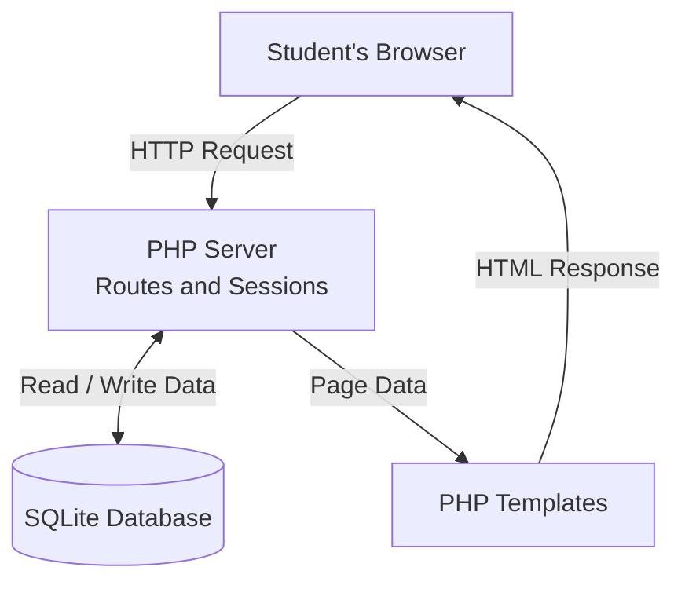

- **Signing up:** The browser submits the registration form to POST /register. The route validates the email domain (.edu) and password, then inserts a user row into SQLite with a hashed password.

- **Signing in:** The login route takes an email and password, queries for the user, hashes the submitted password, and compares it to the stored hash. On match, a session is created and the user sees their vault.

- **Forgot password:** The form at POST /forgot-password generates a random token and stores its SHA-256 digest in the reset_tokens table with a created_at timestamp. The token is returned to the user (sent by email in production).

- **Resetting the password:** POST /reset takes an email, token, and new password. It deletes the matching reset_tokens row from today and updates the user's password in a transaction. If the password update fails, the token deletion rolls back.

- **Vault ownership:** Protected routes use session checks. Viewing a secret additionally checks that the logged-in user owns it. Each user sees only their own secrets.

- **Page rendering:** Routes pass database results to PHP templates, which produce HTML for the browser.
