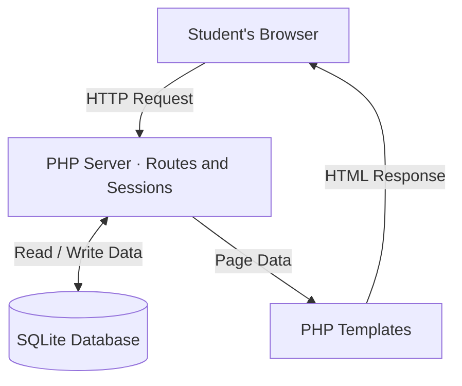

- **Storing a secret:** The browser submits a form to POST /items. The route uses require_login(), validates the fields, and inserts a SQLite row associated with the logged-in user's ID. It redirects the browser to view the personal vault.

- **Authentication and ownership:** Registration and password updates pass the password through hash_password(), which stores a SHA-256 hash in SQLite. Sign-in uses verify_password() and stores the user's ID in the PHP session. Protected item routes use require_login(). The vault query binds the logged-in user's ID to WHERE user_id = ?, so each account sees its own rows. The seeded advisor account has its own shelf for org-wide holds; its role does not give members access to that shelf.

- **Password reset:** POST /forgot issues a reset token for an existing account and returns a generic notice. After the patch, the token is random, only its SHA-256 digest is stored, and POST /reset requires a matching record created that UTC calendar day. The token is deleted in the same transaction that updates the password, preventing reuse. The supplied app has no implemented mail delivery; valid reset testing uses the local issuance helper.

- **Page rendering:** The front controller passes database results to PHP templates, which produce HTML for the browser. Displayed values are escaped through e().
