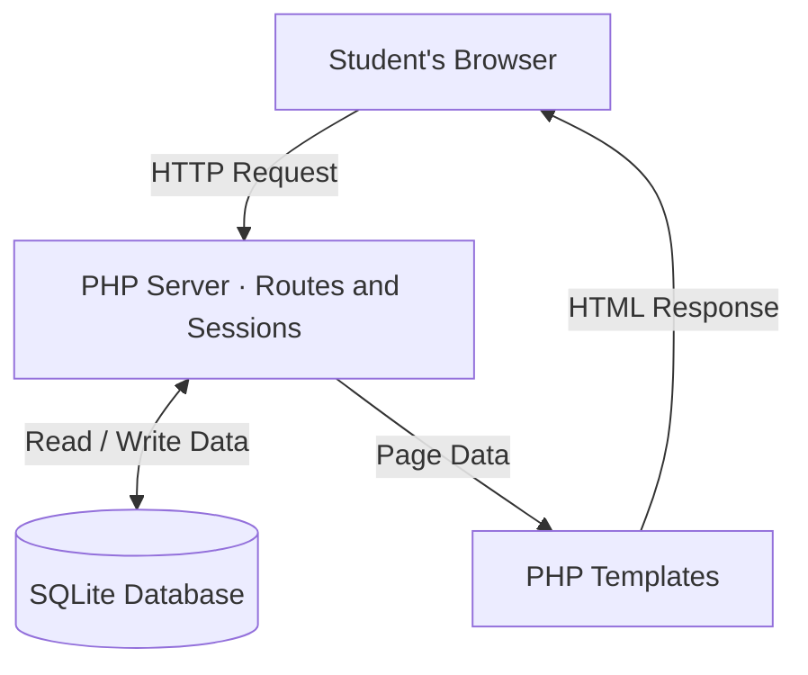

- **Signing up:** The browser submits the registration form to POST /register. The route validates the email domain (.edu) and password, then inserts a user row into SQLite with a hashed password.

- **Signing in:** The login route takes an email and password, queries for the user, hashes the submitted password, and compares it to the stored hash. On match, a session is created and the user sees their vault.

- **Forgot password:** The browser submits the form to POST /forgot. For an existing account, the route generates a random token and stores its SHA-256 digest in reset_tokens with a created_at timestamp. It returns a generic notice. The supplied app does not send email or display the token; valid local reset testing uses the issuance helper.

- **Resetting the password:** POST /reset takes an email, token, and new password. It deletes the matching reset_tokens row from today and updates the user's password in a transaction. If the password update fails, the token deletion rolls back.

- **Vault ownership:** Protected item routes use require_login(). The vault query filters rows using the logged-in user's ID, so each account sees only its own secrets.

- **Advisor account:** The seeded advisor account has its own vault for org-wide holds. Its secrets are scoped to that account, just like other users' secrets.

- **Page rendering:** Routes pass database results to PHP templates, which produce HTML for the browser.
